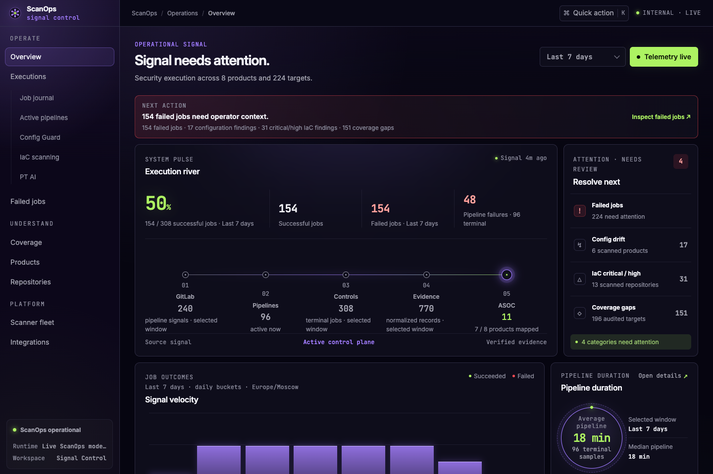
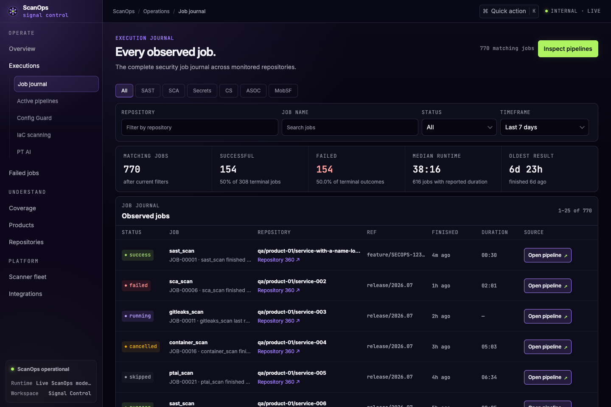
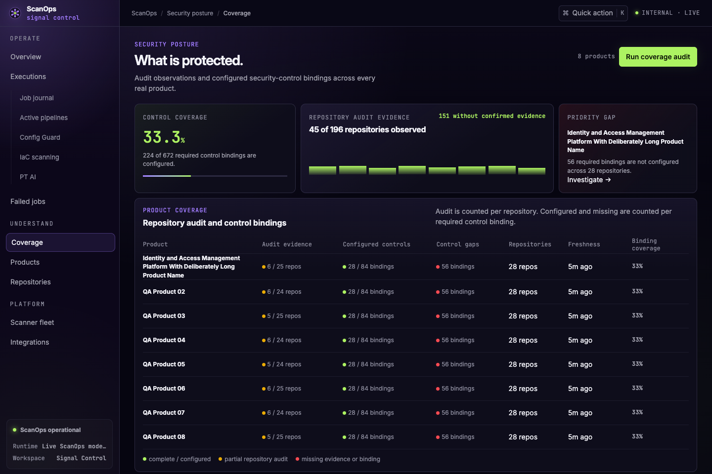

# ScanOps

[](https://github.com/drenderyga-del/secops/actions/workflows/checks.yml)
[](LICENSE)

**One place to see what your security pipelines actually did.**

ScanOps brings GitLab security jobs, scan coverage and report delivery into one
workspace, organized by product and repository. Follow an execution from its
first event to its outcome, then open the evidence that needs attention.

## What it does

- **Track executions.** See running, failed and completed work; filter the job
  journal and inspect failures without switching between pipeline pages.
- **Find coverage gaps.** See which products and repositories have security
  controls, missing scans or stale results.
- **Operate scans.** Check CI configuration with Config Guard, run IaC scans,
  and follow PT AI application scans through their lifecycle.
- **Deliver reports.** Send SARIF to Vampy/Hexway ASOC or DefectDojo, and
  CycloneDX SBOMs to Dependency-Track, with retry-safe delivery records.
- **Work with external AI agents.** Share reviewed job diagnostics through an
  API and receive triage and proposed fixes. Operators review proposals;
  ScanOps does not execute agent commands or apply patches.

## Quickstart

You need **Git** and **Docker with Compose**. No GitLab account, ASOC server or
local Python/Node installation is needed for the demo.

```bash
git clone https://github.com/drenderyga-del/secops.git
cd secops
docker compose -f docker-compose.demo.yml up -d --build
```

After the app becomes healthy and the `seed` container exits successfully,
open **[http://127.0.0.1:18081](http://127.0.0.1:18081)**.
Sign in with **`demo` / `demo`**.

The first run builds the app and fills an isolated database with synthetic
examples. The demo binds to localhost and does not connect to real scanners or
external services. To stop it:

```bash
docker compose -f docker-compose.demo.yml down
```

## A look inside

**Overview — execution outcomes, scan activity and items needing attention.**



<details>
<summary><strong>Job journal and product coverage</strong></summary>

**Job journal — filter executions and investigate failed security jobs.**



**Coverage — find repositories with missing or stale security controls.**



</details>

All screenshots use the local demo and synthetic data.

## Connect your environment

| Start here | What you get |
| --- | --- |
| [Deployment and configuration](docs/setup.md) | Run your own stack, set credentials and connect GitLab. |
| [Execution event API](docs/execution-event-ingestion-v1.md) | Send scanner and job lifecycle telemetry from CI. |
| [ASOC adapters](docs/asoc-adapters.md) | Configure destinations and deliver SARIF or CycloneDX reports. |
| [External agent API](docs/agent-api.md) | Share diagnostics, submit triage and review proposed fixes. |

## Contribute

Built with FastAPI, PostgreSQL, React/Vite and Docker Compose.
See [CONTRIBUTING.md](CONTRIBUTING.md) for development and checks, or
[open an issue](https://github.com/drenderyga-del/secops/issues) for a bug or
feature request. Report vulnerabilities through [SECURITY.md](SECURITY.md).

[MIT licensed](LICENSE).
